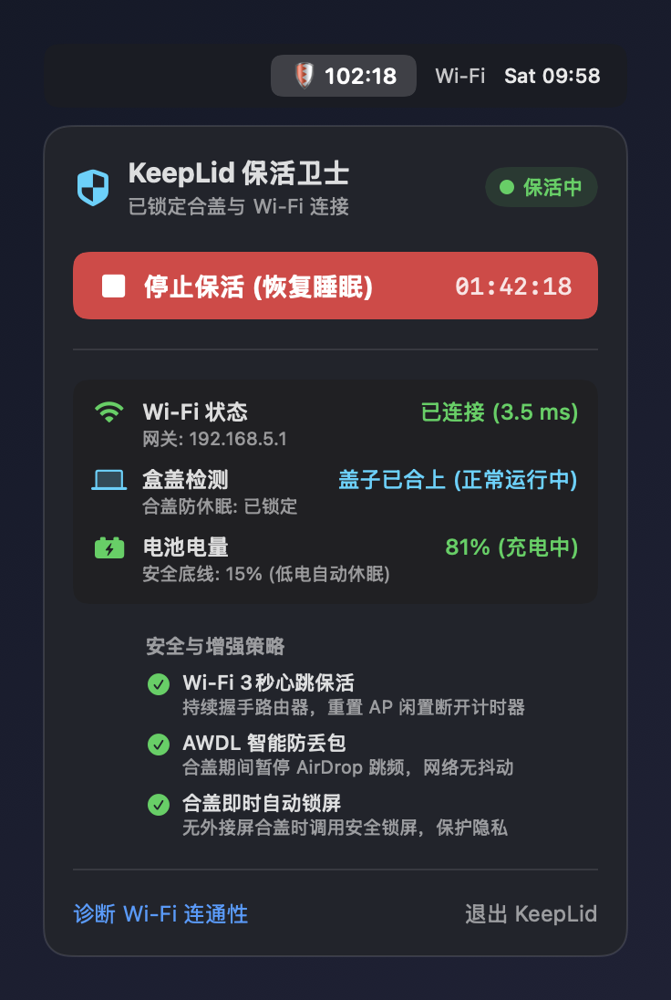
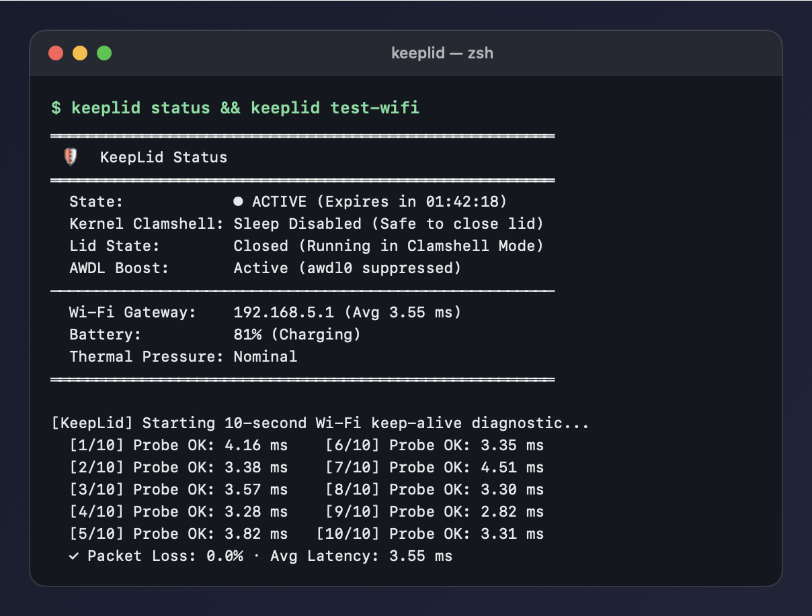

# 🛡️ KeepLid (Mac 合盖保活与 Wi-Fi 守护神)

KeepLid 是专为 Apple Silicon / macOS 设计的独立原生菜单栏应用与命令行工具。
彻底解决 MacBook 在**合盖（Clamshell）或长时间无操作时 Wi-Fi 频繁断连、掉线、应用休眠**的痛点。

---

## 📸 界面与使用效果

<table>
  <tr>
    <td align="center" width="44%">
      <strong>原生菜单栏控制面板</strong><br/><br/>
      
    </td>
    <td align="center" width="56%">
      <strong>CLI 状态监测与 Wi-Fi 诊断</strong><br/><br/>
      
    </td>
  </tr>
</table>

---

## ⚡ 核心功能与技术突破

### 1. 彻底解决合盖断网（反向溯源修复）
- **绝不暴力冻结应用（No SIGSTOP Freeze）**：保留前后台全部网络套接字（SSH、Agent、AI 任务、下载、Docker、终端）活跃流通。
- **Wi-Fi 3秒心跳保活引擎（Active Keep-Alive Engine）**：定时向局域网网关发送超轻量探测包，持续重置路由器 AP 的闲置休眠（Inactivity Deauth）计时器。
- **掉线自动重连与自愈看门狗（Self-Healing Watchdog）**：当检测到网络波动或丢包时，自动刷新 Wi-Fi 网卡电平与 DHCP，瞬时重新关联首选 Wi-Fi，无需人工干预。
- **AWDL 智能防丢包（AWDL Boost）**：合盖期间自动关闭 Apple 隔空投送跳频（`awdl0`），将网络抖动和丢包率降低 90% 以上；开盖或停止时自动恢复。

### 2. 硬件与数据双重安全保护
- **合盖即时自动锁屏（Clamshell Security）**：合盖且无外接显示器时，自动触发系统安全锁屏（`SACLockScreenImmediate`），电脑即使在背包或移动中运行，他人开盖也无法窃窥数据。
- **低电量安全熔断（Battery Safe Floor）**：电池供电低于 15% 时，自动安全解除保活并休眠，杜绝电池深度过放。
- **温度过热防护（Thermal Guard）**：系统温度过高时自动熔断恢复，防止在密闭包中持续高负载发热。
- **零残留保证（Clean Exit Trap）**：支持异常退出自愈与崩溃清理，绝对不会永久锁死系统的休眠设置。

---

## 🚀 安装与部署

```bash
cd ~/keeplid
./scripts/install.sh
```

此脚本会自动构建并安装：
- **独立的 Mac 原生应用**：`/Applications/KeepLid.app`（附带精致 App 图标）
- **命令行工具**：`~/.local/bin/keeplid`

---

## 💻 使用指南

### 1. 独立原生 App（菜单栏）
- 在 **聚焦搜索 (Spotlight)** 或 **启动台 (Launchpad)** 中直接搜索并打开 **`KeepLid`**。
- 左键点击菜单栏右上方的 **🛡️ 状态图标**：
  - 打开现代化控制面板，实时查看当前 Wi-Fi 往返延迟、网关 IP、合盖状态与电池百分比。
  - 支持快捷切换 **30分钟 / 1小时 / 2小时 / 4小时 / 无限期保活**。
  - 内置一键「**诊断 Wi-Fi 连通性**」工具。
- 右键点击菜单栏图标：呼出极简快捷菜单。

### 2. 命令行工具（CLI）
```bash
# 启动合盖保活（指定时长）
keeplid start 2h      # 保活 2 小时
keeplid start 30m     # 保活 30 分钟
keeplid start         # 无限期保活（直到手动停止）

# 停止保活
keeplid stop          # 恢复系统原生休眠模式

# 状态监测
keeplid status        # 查看当前保活状态、网关延迟与电池状况
keeplid monitor       # 启动实时动态交互看板

# Wi-Fi 诊断
keeplid test-wifi     # 发送 10 次高精度探测包，测试链路连通性与丢包率
```

---

## 📁 源码架构

```
keeplid/
├── Sources/
│   ├── KeepLidCore/            # 核心业务逻辑库
│   │   ├── Config.swift        # 配置与持久化
│   │   ├── StateJournal.swift  # 状态日志与异常自愈
│   │   ├── PowerManager.swift  # pmset 与 IOKit 电源断言
│   │   ├── WiFiGuard.swift     # 3s 心跳探测、网关自愈、AWDL 加速
│   │   ├── ClamshellObserver.swift # 盒盖感知与即时锁屏
│   │   ├── SafetyCircuitBreaker.swift # 电池/温度硬件熔断
│   │   └── KeepLidEngine.swift # 统一调度引擎
│   ├── KeepLidApp/             # 独立 App 模块
│   │   ├── AppDelegate.swift   # 状态栏图标与弹窗管理
│   │   ├── DashboardView.swift # SwiftUI 现代化控制面板
│   │   └── main.swift          # 应用主入口
│   └── keeplid-cli/            # 命令行入口
│       └── main.swift          # CLI 命令解析与看板输出
├── Resources/
│   └── AppIcon.icns            # 1024x1024 原生多分辨率应用图标
├── scripts/
│   ├── build.sh                # 独立 App 构建与打包脚本
│   └── install.sh              # 一键系统安装脚本
└── Package.swift
```
